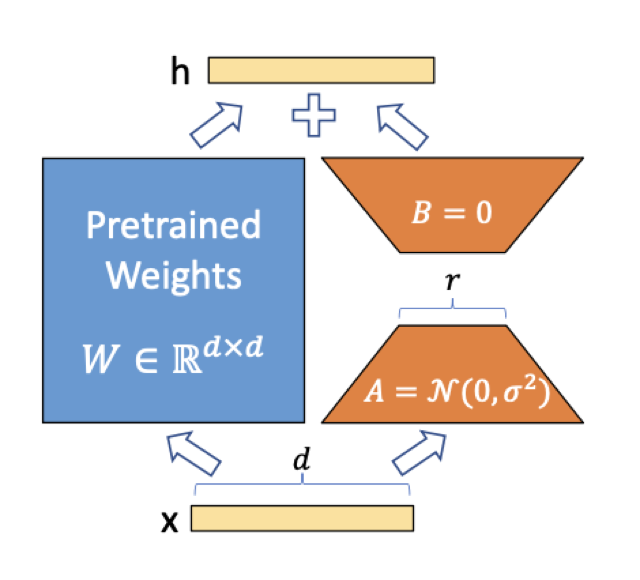
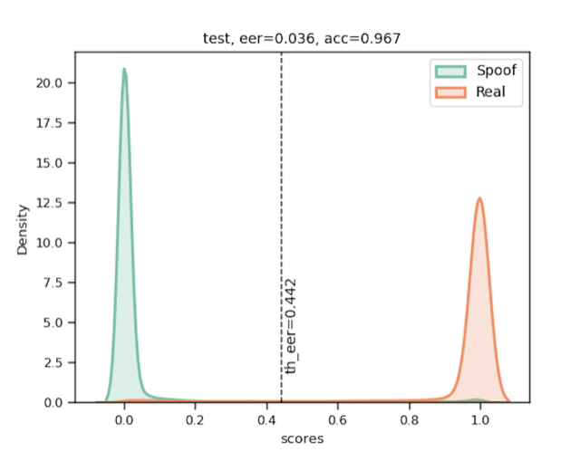
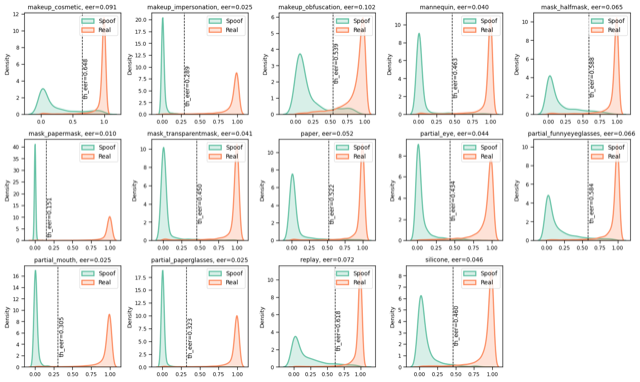
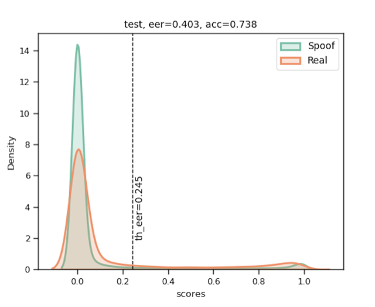
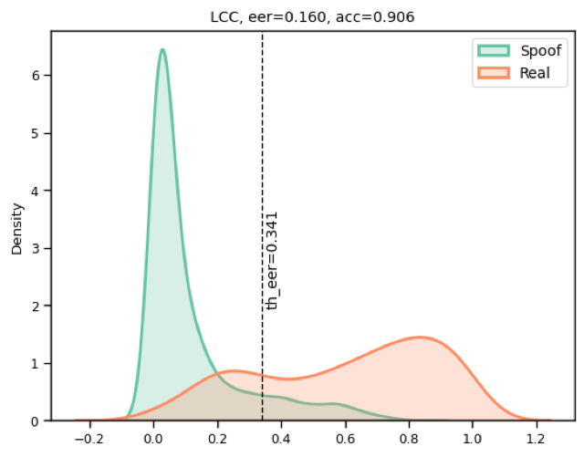
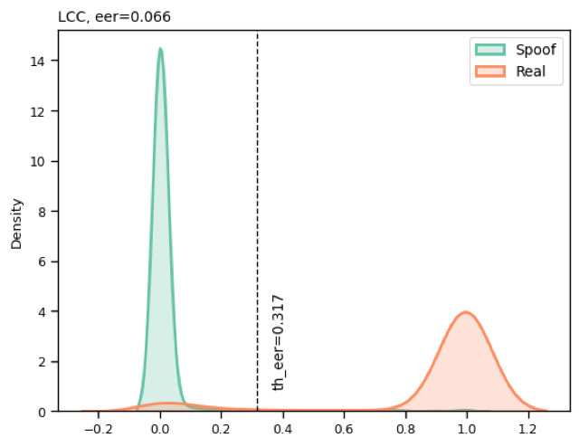

<div align="center">

# Face Anti-Spoofing via Vision Transformers

**Can a pretrained Vision Transformer detect face presentation attacks — and can [LoRA](https://arxiv.org/abs/2106.09685) make it generalize across datasets?**

<a href="https://www.python.org/"></a>
<a href="https://pytorch.org/get-started/locally/"></a>
<a href="https://lightning.ai/"></a>
<a href="https://hydra.cc/"></a>
<a href="https://github.com/psf/black"></a>

Master's thesis · [MSAI](https://www.mipt.ru/), Moscow Institute of Physics and Technology
Author: **Orkun Özoğlu** · Advisor: **Ilya Makarov** · Consultant: **Iurii Efimov**

</div>

---

## Overview

Face anti-spoofing (a.k.a. **presentation-attack detection**, or liveness detection) is the security
layer in front of face recognition: it decides whether the face in front of the camera is a **live
person** or a **spoof** — a printed photo, a replayed video, a paper or silicone mask, makeup, and
so on. Many strong methods lean on auxiliary hardware (depth, IR, thermal); this thesis targets the
harder, cheaper setting: **RGB-only**, fast enough for commodity devices, and — crucially — robust
when deployed on data that looks nothing like the training set.

The central question is whether a **Vision Transformer (ViT-B/16) pretrained on ImageNet-21k** can be
turned into a good spoof detector, and whether **Low-Rank Adaptation (LoRA)** improves its weakest
spot: **cross-dataset generalization**. To our knowledge this is the first application of LoRA to
ViTs for face anti-spoofing.

The work is evaluated under the three standard anti-spoofing protocols:

- **Intra-dataset** — train and test on the same dataset.
- **Cross-dataset** — train on one dataset, test on an entirely unseen one (e.g. CASIA → Replay).
- **Cross-type (leave-one-out)** — on SiW-M, hold out one attack type during training and test only
  on it, measuring generalization to *unseen attacks*.

**TL;DR of the findings.** The pretrained ViT is excellent intra-dataset and on the SiW-M
leave-one-out protocol (≈ 3.8 % average HTER), but collapses across datasets, where it becomes
heavily biased toward rejecting live faces. LoRA fine-tuning **beats the full baseline everywhere it
was tested** — most dramatically on LCC (HTER 20.3 % → 6.6 %) — while training only a tiny fraction
of the parameters. See [Results](#results).

---

## Method

### LoRA-adapted ViT

The backbone is a `ViT-B/16` (16×16 patches, embedding dim 768, ~86.6M parameters) pretrained on
ImageNet-21k. The main model (`spoof.model.vit.LVNetVitLora`) wraps it with a LoRA adapter
(`spoof.model.lora.LoRA_ViT`):

1. The full ViT backbone is **frozen** (`W₀`, no gradient updates).
2. For every transformer block, two low-rank matrices `B ∈ ℝ^{d×r}` and `A ∈ ℝ^{r×k}` are injected
   into the **query** (`W_q`) and **value** (`W_v`) projections of self-attention. The forward pass
   becomes `h = W₀x + ΔWx = W₀x + BAx`, with `r ≪ min(d, k)`. Only `A` and `B` train (`B` is
   zero-initialized, so adaptation starts from the pretrained behavior).
3. A single linear head maps the `[CLS]` embedding to one logit → sigmoid → **liveness score** ∈ `[0, 1]`.

The rank `r` (default `4`) controls the capacity/efficiency trade-off. A torchvision-based ViT with a
frozen backbone and trainable linear head (`spoof.model.vit.VitNet`) is the **full fine-tuning
baseline** for comparison.

<p align="center">
  
  <br><sub><b>LoRA reparametrization.</b> The pretrained weight <code>W₀</code> is frozen; only the rank-<code>r</code> matrices <code>A</code> and <code>B</code> are trained (<code>h = W₀x + BAx</code>).</sub>
</p>

### Face alignment pipeline

Each frame is aligned before it reaches the network (`spoof.dataset.transforms`):

1. Build a square face crop from 7 facial landmarks (`MetaAddLMSquare`).
2. Rotation-compensate using the eye line and crop to **224 × 224**, the ViT's minimum input size
   (`FaceRegionRCXT`).
3. **Training only** — photometric augmentation: color jitter, random Gaussian blur, horizontal flip.
4. Normalize to a `[0, 1]` RGB tensor; per-channel mean/std normalization happens inside the model.

### Metrics

Reported by `spoof.utils.metrics`:

| Metric    | Meaning                                                                      |
| --------- | ---------------------------------------------------------------------------- |
| **ACC**   | Overall classification accuracy at a fixed threshold (higher is better).     |
| **APCER** | Attack Presentation Classification Error Rate — spoofs accepted as live.     |
| **BPCER** | Bona-fide Presentation Classification Error Rate — live faces rejected.      |
| **EER**   | Equal Error Rate (operating point where APCER = BPCER) and its threshold.    |
| **HTER**  | Half Total Error Rate — the average of APCER and BPCER.                      |

---

## Results

> All figures below are from the thesis defense. Models: ViT-B/16 @ 224×224, AdamW
> (`lr = 1e-4`, `weight_decay = 1e-5`). Lower is better for every metric **except ACC**.

### Intra-dataset (baseline ViT)

Strong when the test set matches the training distribution — except on the hard, diverse LCC-FASD,
where the live class suffers (BPCER 35 %).

| Dataset       | ACC ↑ | APCER ↓ | BPCER ↓ | EER ↓ | HTER ↓ |
| ------------- | :---: | :-----: | :-----: | :---: | :----: |
| CASIA-MFSD    | 96.67 |  2.76   |  5.11   | 3.55  |  3.94  |
| Replay-Attack | 97.62 |  1.74   |  4.31   | 2.48  |  3.03  |
| LCC-FASD      | 90.63 |  5.23   |  35.31  | 16.05 | 20.28  |

<p align="center">
  
  <br><sub>Intra-dataset (CASIA): live and spoof liveness scores are cleanly separated.</sub>
</p>

### Cross-type leave-one-out on SiW-M (baseline ViT)

Train on 13 attack types, test on the held-out one — repeated for all 14 attacks. The pretrained ViT
generalizes well to **unseen attack types** within the same dataset.

| Held-out attack | ACC ↑ | APCER ↓ | BPCER ↓ | EER ↓ | HTER ↓ |
| --------------- | :---: | :-----: | :-----: | :---: | :----: |
| **Average**     | 95.29 |  2.95   |  4.68   | 3.82  |  3.82  |

<details>
<summary>Per-attack breakdown (14 attacks)</summary>

| Attack type            | ACC ↑ | APCER ↓ | BPCER ↓ | EER ↓ | HTER ↓ |
| ---------------------- | :---: | :-----: | :-----: | :---: | :----: |
| Makeup — Cosmetic      | 94.89 |  9.15   |  3.75   | 5.91  |  6.45  |
| Makeup — Impersonation | 95.53 |  0.23   |  5.23   | 1.83  |  2.23  |
| Makeup — Obfuscation   | 92.96 |  8.94   |  6.58   | 10.16 |  7.76  |
| Partial — Eye          | 94.49 |  1.52   |  5.95   | 3.58  |  3.73  |
| Partial — Funny Glasses| 95.98 |  2.43   |  4.16   | 3.73  |  3.80  |
| Partial — Mouth        | 95.82 |  0.75   |  4.50   | 2.25  |  2.63  |
| Partial — Paper Glasses| 96.39 |  0.61   |  4.10   | 1.93  |  2.36  |
| Mask — Half            | 95.62 |  2.45   |  4.34   | 3.80  |  3.89  |
| Mask — Paper           | 95.54 |  0.20   |  4.66   | 0.78  |  2.43  |
| Mask — Mannequin       | 95.96 |  0.20   |  4.66   | 0.78  |  2.43  |
| Mask — Transparent     | 95.66 |  3.14   |  4.13   | 3.95  |  3.64  |
| Mask — Silicone        | 94.97 |  0.98   |  5.19   | 3.36  |  3.09  |
| Replay                 | 94.99 |  5.98   |  3.96   | 5.27  |  4.97  |
| **Average**            | 95.29 |  2.95   |  4.68   | 3.82  |  3.82  |

</details>

<p align="center">
  
  <br><sub>Per-attack score distributions for the SiW-M leave-one-out protocol (one panel per held-out attack).</sub>
</p>

### Cross-dataset (baseline ViT)

The hard case. Performance drops sharply, and the model becomes strongly biased toward predicting
*spoof* — note the very high BPCER (live faces wrongly rejected) when transferring to a different
camera/attack distribution.

| Cross-test     | ACC ↑ | APCER ↓ | BPCER ↓ | EER ↓ | HTER ↓ |
| -------------- | :---: | :-----: | :-----: | :---: | :----: |
| CASIA → Replay | 73.83 |  6.33   |  87.60  | 40.25 | 46.97  |
| Replay → CASIA | 65.63 |  17.85  |  83.33  | 49.23 | 50.59  |
| LCC → SiW-M    | 66.27 |  38.85  |  31.32  | 35.46 | 35.09  |
| SiW-M → LCC    | 49.76 |  56.15  |  13.08  | 30.98 | 34.62  |

<p align="center">
  
  <br><sub>Cross-dataset (CASIA→Replay): the distributions collapse into each other — the failure mode this thesis targets.</sub>
</p>

### Effect of LoRA (baseline vs. LoRA)

LoRA improves ACC, EER and HTER in every configuration tested, and sharply reduces the live-rejection
bias (BPCER). The standout is intra-dataset LCC, where HTER drops from 20.3 % to **6.6 %**.

| Test         | Variant     | ACC ↑     | APCER ↓ | BPCER ↓   | EER ↓      | HTER ↓     |
| ------------ | ----------- | :-------: | :-----: | :-------: | :--------: | :--------: |
| LCC → SiW-M  | Baseline    | 66.27     |  38.85  | 31.32     | 35.46      | 35.09      |
| LCC → SiW-M  | **+ LoRA**  | **77.80** |  53.28  | **7.59**  | **29.45**  | **30.42**  |
| SiW-M → LCC  | Baseline    | 49.76     |  56.15  | 13.08     | 30.98      | 34.62      |
| SiW-M → LCC  | **+ LoRA**  | **54.96** |  51.01  | **7.65**  | **28.95**  | **29.33**  |
| LCC (intra)  | Baseline    | 90.64     |  5.23   | 35.31     | 16.05      | 20.28      |
| LCC (intra)  | **+ LoRA**  | **96.65** |  2.13   | **11.12** | **6.61**   | **6.62**   |

<p align="center">
  
  
  <br><sub><b>LoRA on LCC (intra-dataset).</b> Baseline (left, EER 16.0%) vs. LoRA (right, EER 6.6%) — the live/spoof overlap largely disappears.</sub>
</p>

### Takeaways

- A pretrained ViT is **excellent intra-dataset** and on the **cross-type (leave-one-out)** protocol,
  but **generalizes poorly across datasets**, where it underfits and skews toward predicting *spoof*
  (low APCER, high BPCER).
- **LoRA beats the full fine-tuning baseline** in every test, while training only a small set of
  low-rank adapters. Its biggest gains are intra-dataset; its impact on *cross-dataset*
  generalization is real but limited.
- Self-attention maps are reasonable even though the backbone was never trained on faces.
- The cross-dataset results reported in the baseline literature appear optimistic and hard to
  reproduce.
- **Future work:** adapt other attention weights with LoRA and explore the rank `r`.

---

## Repository structure

```
spoof/
├── config/                   # Hydra / YAML experiment configs
│   ├── train.yaml            #   LoRA-ViT · SiW-M leave-one-out protocol
│   ├── train_lora.yaml       #   LoRA-ViT · cross-dataset (CASIA+Replay → LCC)
│   ├── test.yaml             #   SiW-M test split
│   └── test_lora.yaml        #   paper/replay test split
├── src/spoof/
│   ├── model/
│   │   ├── vit.py            # LVNetVitLora (main), VitNet (baseline), BaseViT
│   │   ├── lora.py           # LoRA_ViT low-rank adapter wrapper
│   │   └── baseline.py       # DummyModel
│   ├── dataset/
│   │   ├── dataset.py        # FaceDataset, FaceDatasetLeaveOneOut
│   │   ├── transforms.py     # landmark-based alignment & rotation-compensated crop
│   │   ├── transforms_img.py # photometric augmentations
│   │   ├── prepare.py        # CASIA / Replay frame + annotation extraction
│   │   ├── leave_one_out.py  # SiW-M annotation builder
│   │   └── loader.py         # threaded DataLoader helper
│   ├── loss/                 # MultiLoss + binary / multi-class classifiers
│   ├── utils/                # metrics (EER/APCER/BPCER/HTER), visualization
│   ├── training_system.py    # PyTorch Lightning modules
│   ├── train.py              # standard training loop
│   ├── train_loo.py          # cross-type leave-one-out training loop
│   └── validate.py           # evaluation loop
├── scripts/                  # standalone train / validate entry points
├── notebooks/                # analysis: attention maps, score distributions
├── tests/                    # pytest suite
├── Makefile
└── setup.py
```

---

## Installation

```bash
git clone https://github.com/ozogxyz/spoof.git
cd spoof

python -m venv .venv && source .venv/bin/activate   # or use conda
pip install -e .
```

This installs the `spoof` package along with PyTorch, torchvision, PyTorch Lightning, Hydra,
OpenCV and `pytorch_pretrained_vit`. Pretrained ViT weights are downloaded automatically on first run.

> **Hardware note** — the training entry points default to Apple Silicon (`accelerator="mps"`).
> For an NVIDIA GPU pass `--device <gpu_id>`; for CPU-only, set the accelerator accordingly in the
> trainer setup.

---

## Data preparation

| Dataset           | Characteristics                                            |
| ----------------- | ---------------------------------------------------------- |
| **CASIA-MFSD**    | Basic, low diversity — print and replay attacks.           |
| **Replay-Attack** | Basic, low diversity — replay attacks.                     |
| **LCC-FASD**      | Hard, diverse — print, paper and replay attacks.           |
| **SiW-M**         | Hard, diverse — 14 distinct attack types (masks, makeup, partials, replay). |

The datasets are not redistributed here — request them from their original authors. By default the
configs expect data under `~/spoof/data/` (e.g. `~/spoof/data/siwm/`, `~/spoof/data/lcc/`); adjust
the `annotations_file` paths in `config/*.yaml` to match your layout.

Each dataset is described by an **annotations CSV**, one row per aligned face frame, consumed by
`FaceDataset` with these columns:

| Column                                                              | Description                                |
| ------------------------------------------------------------------- | ------------------------------------------ |
| `image_file`                                                        | Path to the face frame.                    |
| `face_rect_x`, `face_rect_y`, `face_rect_width`, `face_rect_height` | Face bounding box.                         |
| `landmark_1` … `landmark_14`                                        | 7 facial landmarks as `(x, y)` pairs.      |
| `label`                                                             | `1` = live (bona-fide), `0` = spoof.       |
| `spoof_type` *(SiW-M only)*                                         | Attack category, used by the LOO protocol. |

Helper scripts generate these annotations:

```bash
# CASIA / Replay: extract frames from videos and build annotation CSVs
python -m spoof.dataset.prepare --dataset casia  --data_root data
python -m spoof.dataset.prepare --dataset replay --data_root data

# SiW-M: build train/test annotation CSVs (edit paths at the top of the script)
python -m spoof.dataset.leave_one_out
```

---

## Training

Run from the repository root (configs use relative paths).

**Standard training** (single protocol — defaults to the LoRA-ViT config):

```bash
python -m spoof.train \
    --cfg-training config/train.yaml \
    --batch-size 64 \
    --epochs 5 \
    --device 0                      # omit for the default accelerator
```

**Cross-type leave-one-out** on SiW-M — trains one model per held-out attack type and reports
aggregated metrics:

```bash
python -m spoof.train_loo --cfg-training config/train.yaml -b 64 -e 5
```

Checkpoints are written to the experiment directory (`--train_dir`, default `logs/`), named with
their epoch, loss and metric values. TensorBoard logs are written alongside:

```bash
tensorboard --logdir logs/
```

### Configuration

Experiments are fully described by Hydra/YAML files in `config/`. Model, loss and datasets are
swapped declaratively via `_target_` instantiation — no code changes needed. For example,
`config/train.yaml`:

```yaml
model:
  _target_: spoof.model.vit.LVNetVitLora
  num_classes: 1
  rank: 4                       # LoRA rank
loss:
  _target_: spoof.loss.MultiLoss
  weighted_loss_list:
    - 1.0
    - _target_: spoof.loss.ClassifierBinary
      name: bce
      tag_pred: out_logit
      tag_gt: label
data:
  train:    { _target_: spoof.dataset.FaceDatasetLeaveOneOut, mode: train, ... }
  val_base: { _target_: spoof.dataset.FaceDatasetLeaveOneOut, mode: val,   ... }
```

Training uses **AdamW** over the trainable parameters only (LoRA adapters + classification head),
with binary cross-entropy loss. Defaults: `lr = 1e-4`, `weight_decay = 1e-5`, mixed precision (`fp16`).

---

## Evaluation

Validate a trained checkpoint against one or more data configs. The model architecture is restored
from the checkpoint itself, and per-subset scores are dumped as JSON for further analysis:

```bash
python -m spoof.validate \
    --ckpt logs/<your-checkpoint>.ckpt \
    --config-data config/test.yaml \
    --batch-size 64
```

---

## Tests

```bash
pytest
```

The suite covers the data pipeline, the LoRA wrapper, the model, the Lightning training system,
config loading, and visualization helpers.

---

## References & acknowledgements

This thesis builds directly on George & Marcel's zero-shot ViT anti-spoofing work, and adapts the
LoRA-on-ViT implementation from [JamesQFreeman/LoRA-ViT](https://github.com/JamesQFreeman/LoRA-ViT)
on top of the [lukemelas/PyTorch-Pretrained-ViT](https://github.com/lukemelas/PyTorch-Pretrained-ViT)
backbone.

- A. Dosovitskiy et al., *An Image Is Worth 16×16 Words: Transformers for Image Recognition at Scale*, ICLR 2021. [arXiv:2010.11929](https://arxiv.org/abs/2010.11929)
- E. J. Hu et al., *LoRA: Low-Rank Adaptation of Large Language Models*, ICLR 2022. [arXiv:2106.09685](https://arxiv.org/abs/2106.09685)
- A. George and S. Marcel, *On the Effectiveness of Vision Transformers for Zero-shot Face Anti-Spoofing*, IJCB 2021. [arXiv:2011.08019](https://arxiv.org/abs/2011.08019)
- N. Sergievskiy et al., *Generalizable Method for Face Anti-Spoofing with Semi-Supervised Learning*, 2022. [arXiv:2206.06510](https://arxiv.org/abs/2206.06510)
- Z. Zhang et al., *A Face Antispoofing Database with Diverse Attacks* (CASIA-MFSD), ICB 2012.
- I. Chingovska et al., *On the Effectiveness of Local Binary Patterns in Face Anti-spoofing* (Replay-Attack), BIOSIG 2012.
- Y. Liu et al., *Deep Tree Learning for Zero-shot Face Anti-Spoofing* (SiW-M), CVPR 2019.

---

## Author

**Orkun Özoğlu** — [@ozogxyz](https://github.com/ozogxyz)
MSc, Modern State of Artificial Intelligence (MSAI), Moscow Institute of Physics and Technology.
